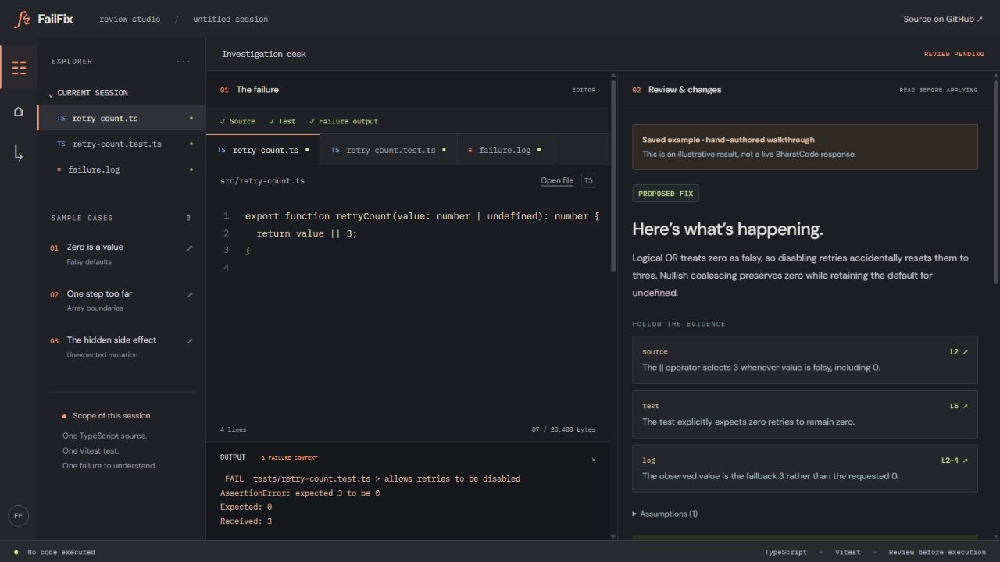
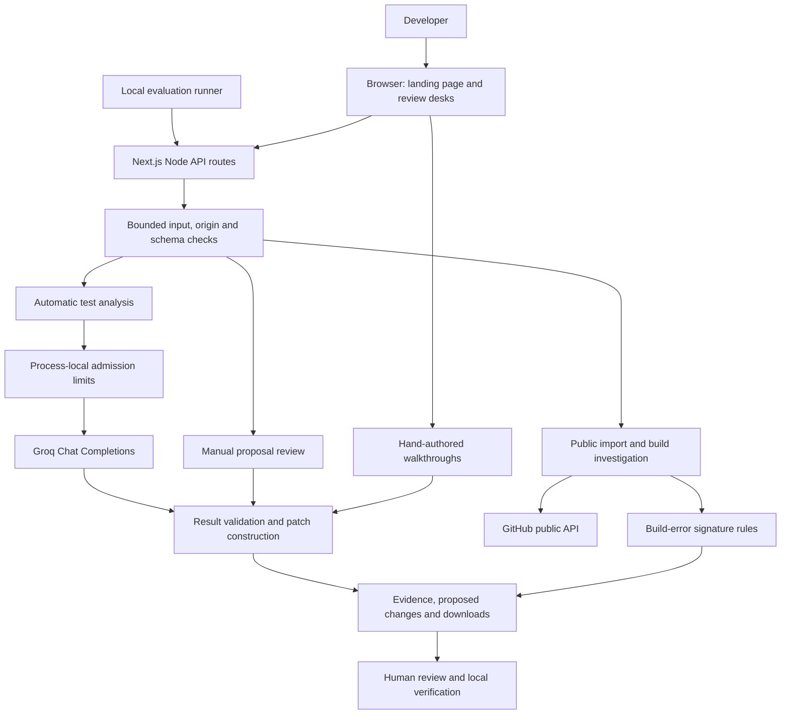
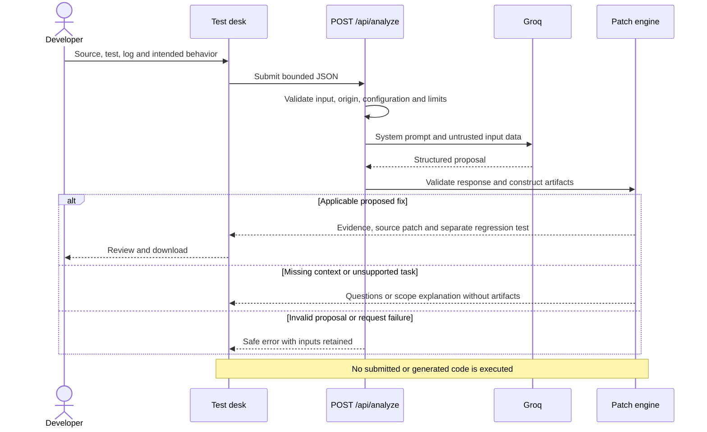
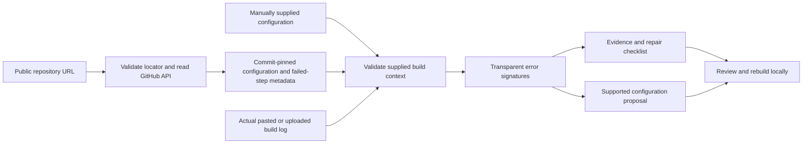
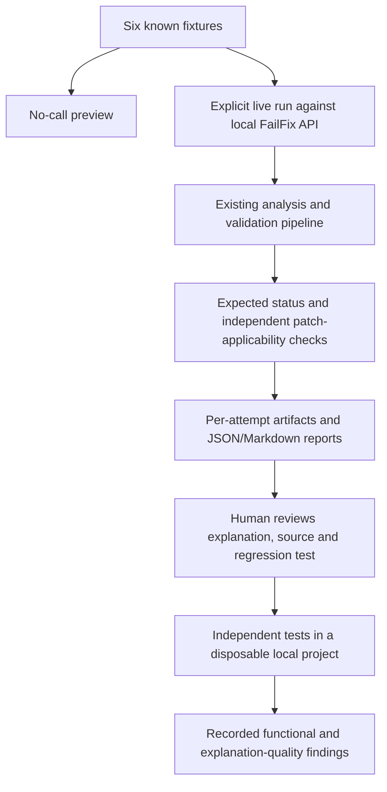

# FailFix

**Understand the failure. Review the fix.**

[](https://github.com/pjha26/Failfix/actions/workflows/ci.yml)

FailFix is a developer workspace for investigating **TypeScript/Vitest failures and deployment build errors**. Connect an explanation to the supplied evidence, inspect a proposed change, and download artifacts for local verification.

Use Groq for automatic test diagnosis, bring a proposal from a chat tool through manual review, or investigate deployment logs with transparent signature checks. Public GitHub configuration import and the manual workflow do not require a model key.



[Quick start](#quick-start) · [Workflows](#workflows) · [Architecture](#architecture) · [AI evaluation](#ai-evaluation) · [Development](#development) · [Limits and privacy](#limits-and-privacy)

## What FailFix does

- **Investigate a focused test failure.** Supply one TypeScript source file, one Vitest test file, failure output, and optional intended behavior.
- **Follow the evidence.** Jump from a diagnosis to the referenced source, test, or log lines.
- **Inspect a proposed repair.** Review the explanation, assumptions, source diff, and separate regression test. Existing tests remain unchanged.
- **Validate applicability.** Reject malformed proposals, invalid line references, ambiguous source matches, overlapping edits, and unsupported literal test imports.
- **Review without an API key.** Explore three hand-authored walkthroughs or validate structured JSON from a chat tool you choose.
- **Bring public build context.** Import supported root configuration and failed GitHub Actions-step metadata pinned to a repository commit, then provide the actual build log.
- **Export reviewed proposals.** Download a unified patch, fixed source, regression test, or build-review report. Editing inputs disables stale exports.

A valid patch means the proposed edits match the supplied text. It does **not** establish correct behavior, successful tests, or a successful deployment. FailFix does not execute uploaded code, apply patches, write to GitHub, or trigger deployments.

## Quick start

### Requirements

- Node.js **22.13 or newer**, compatible with the locked dependencies.
- npm; the repository declares npm **11.6.4**.
- A Groq API key only for automatic test analysis.

```sh
git clone https://github.com/pjha26/Failfix.git
cd Failfix
npx --yes npm@11.6.4 ci
npm run dev
```

Open [localhost:3000](http://localhost:3000). The landing page links to the **test desk** at `/workspace` and **deployment desk** at `/deployments`.

To enable automatic diagnosis, copy `.env.example` to `.env.local`, preserving any existing local configuration, and set the key locally:

```dotenv
GROQ_API_KEY=your_key_here
GROQ_MODEL=openai/gpt-oss-20b
ANALYSIS_ENABLED=true
ANALYSIS_SESSION_LIMIT=100
```

Keep `.env.local` out of Git. Never use `NEXT_PUBLIC_*` for a provider key or paste credentials into source files, logs, or chat. Restart the server after changing its environment.

`npm run check:api` makes a small real connectivity/schema request to Groq. It consumes account resources and does not establish debugging quality. Setup and host configuration are described in the [operations guide](docs/operations.md).

## Workflows

### Test debugging

1. Open `/workspace` and select a saved case or supply your own source, existing test, and failure output.
2. Add intended behavior when the test does not fully specify it.
3. Select **Analyze failure** for a live Groq proposal, **Open saved walkthrough** for a labeled teaching example, or the manual workflow below.
4. If Groq asks for more context, answer in the review panel and select **Reanalyze with context**. FailFix resubmits the same source, test, and log with the clarified behavior.
5. Inspect the explanation, evidence, assumptions, source diff, and new regression test.
6. Review downloaded code before applying it in your own project. Run the original tests, independent checks, and proposed regression test locally. Record the outcome beside the patch for the current session.

Cancellation, invalid input, provider errors, and rejected proposals retain the inputs. Editing inputs marks previous results stale.

### Manual proposal review

Under **Use without an API key**, prepare a debugging prompt from your inputs. Review it before sending nonconfidential code to a chat service you choose. Paste that service's JSON proposal into FailFix and select **Validate proposal**.

The manual route checks the proposal and constructs artifacts without calling Groq. A single complete JSON code fence is accepted; surrounding explanations are rejected. Manual results are labeled separately from live responses and saved examples.

### Deployment investigation

Open `/deployments`, enter a public GitHub repository URL, and import supported configuration—or paste configuration yourself. Add the actual failing build output and select **Investigate build**.

The deployment desk recognizes signatures for missing build scripts, lockfile mismatches, Node compatibility, missing environment settings, module resolution, TypeScript errors, and memory pressure. These are rule-based findings. A narrowly supported Next.js missing-build case can produce a proposed `package.json` patch; other findings provide verification steps or ask for more context.

Public import reads limited configuration and failed-run metadata. It does not clone the repository or download logs, artifacts, secrets, or private repositories. Read the [deployment workflow guide](docs/deployments.md) for supported files and boundaries.

## Architecture

FailFix uses one Next.js application for the browser interface and Node.js API. There is no database or separate backend service.



### Automatic test-analysis sequence



### Deployment workflow



### API surface

| Route                           | Purpose                                                            |
| ------------------------------- | ------------------------------------------------------------------ |
| `POST /api/analyze`             | Groq-assisted test diagnosis followed by local proposal validation |
| `POST /api/review`              | Validate a user-supplied proposal without a model request          |
| `GET /api/examples/[id]`        | Return a labeled, validated saved walkthrough                      |
| `POST /api/github/import`       | Import supported public configuration and run metadata             |
| `POST /api/deployments/analyze` | Review build-error signatures and supported repair proposals       |
| `GET /api/health`               | Report application availability without a provider request         |

See [architecture details](docs/architecture.md) for request boundaries and manual-review sequences.

## AI evaluation

The local runner exercises six first-party cases: zero values, boundary indexing, input mutation, multiple edits, missing context, and embedded instruction injection. It records responses for review, rather than asking another model to grade its own work.



Preview without a server or provider request:

```sh
npm run eval:ai
```

With a configured local server running, explicitly request one live pass:

```sh
node scripts/evaluate-ai.mjs --live
```

Select cases and repeat attempts when investigating consistency:

```sh
node scripts/evaluate-ai.mjs --live --case zero --case needs-context --repeat 2 --base-url http://127.0.0.1:3000
```

Live evaluation consumes the configured Groq account's resources. Results are saved under ignored `evals/runs/`; generated source and tests are stored as text and never executed by the runner. Reports distinguish API acceptance, expected response category, patch applicability, pending human review, and unperformed functional checks. **An accepted response is not an accuracy score.**

See the [evaluation guide](docs/evaluation.md) for output files, stopping conditions, provenance, and the review protocol. Detailed observations belong in the [evaluation record](evals/results.md).

## Technology

| Area               | Tools                                                                                                  |
| ------------------ | ------------------------------------------------------------------------------------------------------ |
| Application        | Next.js App Router, React, TypeScript, Node.js                                                         |
| Interface          | CSS, SVG, native scroll/IntersectionObserver behavior, DM Sans and IBM Plex Mono with system fallbacks |
| AI                 | Native `groq-sdk`, strict structured Chat Completions output                                           |
| Validation         | Zod request/result schemas and explicit trust-boundary checks                                          |
| Patch construction | `diff` unified patches and exact source matching                                                       |
| Testing            | Vitest, Vite, Playwright                                                                               |
| Quality and CI     | TypeScript, ESLint, GitHub Actions                                                                     |

Dependency versions are defined in `package.json` and locked in `package-lock.json`. The evaluation runner uses existing dependencies and Node APIs.

## Development

```sh
npm test
npm run typecheck
npm run lint
npm run build
npx playwright install chromium
npm run test:browser
```

On Windows, installed Chrome can be used by setting `PLAYWRIGHT_CHANNEL=chrome` before the browser command. The browser suite starts a production server on port 3006, so build first and keep that port available. Live model calls are excluded from CI; runner tests use mocked HTTP responses.

For a local production server:

```sh
npm run build
npm start
```

Relevant source locations:

```text
app/                 Routes, layouts and API handlers
components/          Test desk, deployment desk, result review and landing scenes
lib/                 Contracts, provider integration, patch engine and build rules
scripts/             Provider connectivity check and evaluation runner
tests/               Unit, API, SDK and browser checks
evals/cases/         First-party evaluation fixtures
evals/runs/          Ignored generated proposals and per-run reports
docs/                Architecture, evaluation, deployment and operation guides
```

## Limits and privacy

| Boundary              | Supported scope                                                                   |
| --------------------- | --------------------------------------------------------------------------------- |
| Test input            | One `.ts` source and one `.test.ts` or `.spec.ts` file, up to 20 KiB each         |
| Test failure output   | Up to 12 KiB; intended behavior up to 2 KiB                                       |
| Analysis request      | Up to 64 KiB total                                                                |
| Manual review         | Proposal up to 48 KiB; combined review body up to 128 KiB                         |
| Proposed source edits | At most three exact, nonoverlapping edits                                         |
| Deployment context    | Build log up to 32 KiB and at most four supported text configs, up to 16 KiB each |
| Repository access     | Limited public configuration and run metadata; read-only                          |

TSX, repository-wide repairs, private-account access, automatic pull requests, automatic patch application, and hosted code/test execution are outside the supported workflow. Literal test-import checks are limited validation, not a sandbox. Explanations, evidence usefulness, syntax, behavior, and safety still require review.

Automatic analysis sends supplied code and logs to Groq. Manual review sends its inputs to the FailFix server without a provider call; copying a prompt into another service is your choice. [Groq data controls](https://console.groq.com/docs/your-data) apply. FailFix makes no provider-side zero-retention claim.

Application inputs and results are held in session memory rather than a database or browser storage. Operational logs contain request metadata rather than source or prompt text. The evaluation CLI explicitly saves its first-party inputs and proposals to local ignored files. The interface requests Google Fonts with system-font fallbacks.

The analysis gate allows two concurrent requests and defaults to 100 accepted analyses per process lifetime. Counters reset on restart and are not shared across replicas or a durable billing cap. Use a single process/replica with the current limiter and read the [operations guide](docs/operations.md) before hosting publicly.

## Contributing and license

Report reproducible problems through [GitHub issues](https://github.com/pjha26/Failfix/issues), including expected behavior and a small nonconfidential example. Keep credentials and private source out of reports. For changes, update relevant documentation and run the checks that cover the affected behavior.

FailFix is maintained by [pjha26](https://github.com/pjha26). This repository does not currently declare a project license.
