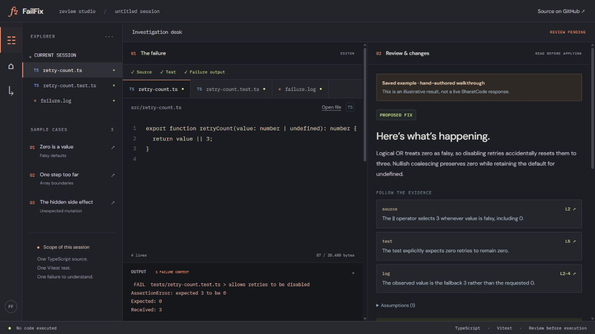
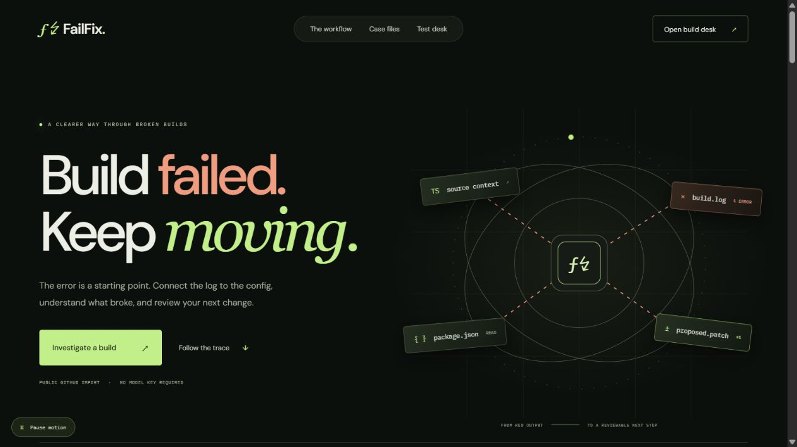
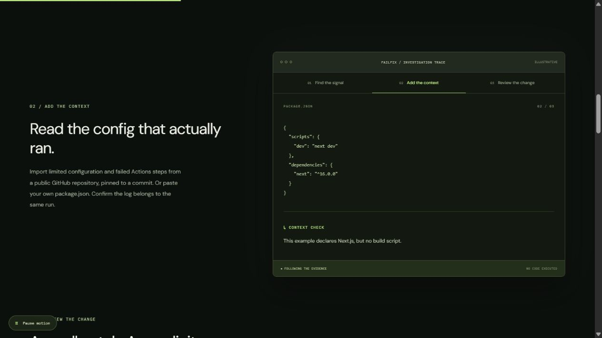
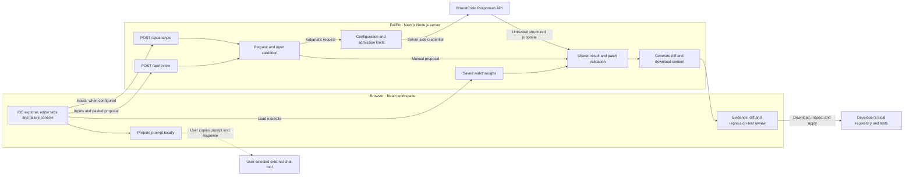
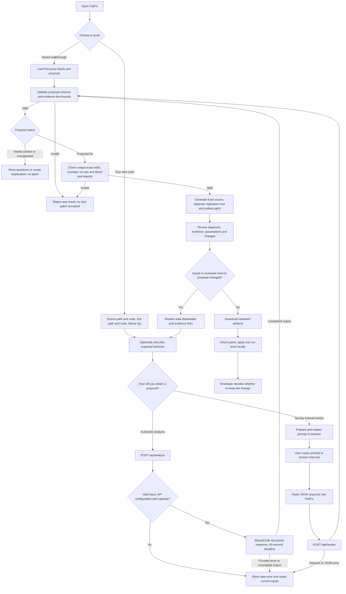

# FailFix

**Understand the failure. Review the fix.**

[](https://github.com/pjha26/Failfix/actions/workflows/ci.yml)

FailFix is a review workspace for **build failures and TypeScript + Vitest bugs**. The [deployment desk](docs/deployments.md) imports limited public GitHub configuration, matches build-error signatures, and offers repair steps or narrowly supported patches without a model key. The test-debugging desk handles failing TypeScript/Vitest tests. Bring one source file, its test, and the failure output. Follow a diagnosis back to the supplied lines, inspect a focused source patch, and review a separate regression test before trying the changes locally.

**You can try it without an API key.** Open a saved walkthrough, or bring a JSON proposal from a chat tool you already use. Automatic BharatCode analysis is implemented, but live provider compatibility and debugging quality remain unverified pending API access.



[Quick start](#quick-start) · [Usage](#how-to-use-the-test-debugging-desk) · [Architecture](#architecture) · [Complete workflow](#complete-workflow) · [Development](#development) · [Limitations](#limitations)

## The problem

A plausible fix is only the beginning. You still need to understand the failure, check which lines support the explanation, inspect what will change, and decide how to test it.

FailFix puts those review steps in one desk. Its focus is the **review between a proposed fix and local execution**. It fits alongside a coding agent or chat tool: you can bring that tool's proposal into FailFix rather than changing how you generate it.

## What you can do

- **Investigate in an IDE layout.** Switch between source, test, and failure-log tabs; collapse the case explorer without losing edits.
- **Follow the evidence.** Jump from a diagnosis to referenced lines in the supplied inputs.
- **Inspect proposed changes.** Review the source diff, assumptions, and a separate regression test. Existing tests stay unchanged.
- **Check applicability.** Reject malformed proposals, out-of-range evidence, ambiguous source matches, overlapping edits, and unsupported literal test imports.
- **Export for local verification.** Download a unified patch, fixed source, or regression test. Changing the inputs or a reviewed manual proposal disables stale exports.
- **Start without provider access.** Use three hand-authored walkthroughs or the manual review flow.

> A patch that matches the supplied source is not proof of a correct fix. FailFix does not execute your code, run tests, or modify your repository.

<details>
<summary>See the scroll-driven homepage</summary>





</details>

## The interface

The homepage tells the investigation story through native scroll reveals, a moving SVG build trace, and a sticky three-chapter preview. Motion can be paused and follows reduced-motion preferences; content remains readable without JavaScript. There is no scroll hijacking or animation-library dependency. The build desk at `/deployments` and test desk at `/workspace` keep editing and review interactions separate from the presentation.

## Quick start

### Requirements

- Node.js **22.13 or later**, on a release compatible with the locked dependencies.
- Git and npm. The tested installer is **npm 11.6.4**; npm 11.5.2 encountered a dependency-resolver crash on Windows.

```sh
git clone https://github.com/pjha26/Failfix.git
cd Failfix
npx --yes npm@11.6.4 ci
npm run dev
```

Open [localhost:3000](http://localhost:3000). Select **Investigate a build** for public repository context and log review. Scroll to the case files for saved TypeScript walkthroughs, or open `/workspace` for your own source and test.

No environment file, account, or API key is required for saved examples and manual review. Inputs and results are kept in memory; refreshing or leaving the workspace loses the session.

## Investigate a deployment failure

Open `/deployments`, import a public GitHub repository or paste package.json, and add the actual failing build output. Select **Investigate build** to view matched error lines, a repair checklist, and an optional supported config patch. You can also start with **Try a build-failure example**.

Public import reads supported root configuration and failed Actions-step metadata at a specific commit. It does not download logs, clone repositories, connect accounts, or write to GitHub. Private repository access and account connection are deferred. No model API is used by build signature review. See [deployment workflow and boundaries](docs/deployments.md).

## How to use the test-debugging desk

| Mode               | What supplies the diagnosis?                     | Provider key in FailFix? | Result label                                  |
| ------------------ | ------------------------------------------------ | ------------------------ | --------------------------------------------- |
| Saved walkthrough  | First-party, hand-authored example               | No                       | Saved example                                 |
| Manual review      | JSON you paste from your chosen chat tool        | No                       | User-supplied proposal                        |
| Automatic analysis | Server-side BharatCode Responses API integration | Yes                      | Proposed fix, questions, or unsupported scope |

### 1. Explore a saved case

Choose a case in the homepage case files to see its inputs and reviewed example result immediately. In the workspace, selecting a case loads its inputs; select **Open saved walkthrough** to view the result.

| Case                   | Bug illustrated                           | Proposed change                              |
| ---------------------- | ----------------------------------------- | -------------------------------------------- |
| Zero is a value        | A fallback overwrites a valid zero        | Use nullish coalescing instead of logical OR |
| One step too far       | An index points past the final array item | Use the last valid index                     |
| The hidden side effect | Sorting changes the caller's array        | Sort a copy                                  |

These are illustrative walkthroughs, not recorded model responses or remotely executed tests.

### 2. Review your own code without a key

1. Open `/workspace`. Paste or open a `.ts` source file and a `.test.ts` or `.spec.ts` test. Set their relative repository paths.
2. Add the relevant Vitest failure output. Optionally describe what should happen.
3. Under **Use without an API key**, select **Prepare debugging prompt**. Review the prompt before copying it; it includes the supplied code and logs.
4. Paste it into a chat tool you already have access to, then copy that tool's JSON response.
5. Paste the response into **Proposal JSON** and select **Validate proposal**. Plain JSON or one complete JSON code fence is accepted; surrounding prose is rejected.
6. Inspect the diagnosis, evidence, diff, and proposed regression test. Then download and verify locally.

FailFix prepares the prompt in the browser. It does not send it to a chat service for you. Manual validation sends the inputs and proposal to FailFix's own `/api/review` route, which makes no provider request. External chat services may have their own costs, limits, and privacy terms.

### 3. Enable automatic analysis (optional)

Copy `.env.example` to `.env.local`, set your server-side `BHARATCODE_API_KEY`, and restart the app. Never commit the key or put it in a `NEXT_PUBLIC_*` variable.

| Variable                   | Default                        | Purpose                                                       |
| -------------------------- | ------------------------------ | ------------------------------------------------------------- |
| `BHARATCODE_API_KEY`       | Unset                          | Required only for automatic analysis                          |
| `BHARATCODE_MODEL`         | `qwen-3.8-27b`                 | Model identifier sent to BharatCode                           |
| `ANALYSIS_ENABLED`         | `true`                         | Set exactly `false` to pause automatic analysis               |
| `ANALYSIS_SESSION_LIMIT`   | `100`                          | Accepted analyses per server process                          |
| `APP_ORIGIN`               | Request protocol + Host header | Canonical site origin when deployed behind a proxy            |
| `TRUSTED_CLIENT_IP_HEADER` | Unset                          | Optional host-verified single-IP header for per-client limits |

Supply the same inputs and select **Analyze failure**. The integration uses the OpenAI SDK against BharatCode's endpoint; an OpenAI key is not used by this integration. Provider access must be enabled for the configured account and model. See [operations](docs/operations.md) before configuring a public host.

### 4. Apply and verify locally

Review the downloaded patch and generated test first. Check that the proposed new test path does not already exist in your repository. From your own project directory:

```sh
git apply --check failfix.patch
git apply failfix.patch
# Use your project's normal test command; for a standard Vitest project:
npx vitest run
```

Run the apply step only if the check succeeds and you approve the changes. Downloading a file does not apply it. FailFix cannot inspect files outside the two you supplied or detect every collision in your full repository.

## Architecture

One Next.js application serves the IDE interface and Node.js API routes. There is no database, account system, repository write integration, or hosted code runner. Public GitHub build-context import is described in [the deployment architecture](docs/deployments.md).



All three modes share `buildArtifacts` in [`lib/patch.ts`](lib/patch.ts). The model or chat tool supplies a structured proposal; FailFix validates it and generates the diff itself. External chat use in manual mode is a user action, not a server integration.

## Complete workflow



See [the detailed architecture](docs/architecture.md) for route responsibilities, request sequences, and trust boundaries.

## Technology and repository layout

| Layer                      | Implementation                                         |
| -------------------------- | ------------------------------------------------------ |
| Web application            | Next.js 16 App Router, React 19, TypeScript 6          |
| Interface                  | CSS, browser text/file APIs, responsive IDE layout     |
| Validation                 | Zod schemas and explicit UTF-8 byte limits             |
| Patch generation           | `diff`, exact-text source edits                        |
| Optional model integration | OpenAI SDK pointed at BharatCode's Responses endpoint  |
| Verification               | Vitest, Playwright, ESLint, TypeScript, GitHub Actions |

```text
app/
  page.tsx                    Scroll-driven investigation story
  workspace/page.tsx          Test workspace and deep-linked saved cases
  deployments/page.tsx        Public repository and build-log investigation
  api/github/import/route.ts  Credential-free public configuration import
  api/deployments/analyze/route.ts  Build-error signature review
  api/analyze/route.ts        Optional automatic test diagnosis
  api/review/route.ts         No-key proposal validation
  api/examples/[id]/route.ts  Saved walkthrough results
  api/health/route.ts         Process health, no model call
components/                  IDE chrome, editor, manual flow, result review
lib/                         Contracts, request checks, patch engine, provider, limits
tests/                       Unit, API, SDK-mocked and browser checks
evals/                       First-party cases and evaluation status
docs/                        Architecture, operations, demo and project notes
```

## Development

```sh
npm test
npm run typecheck
npm run lint
npm run build
npx playwright install chromium
npm run test:browser
```

Browser tests launch a **production** server on port `3006`; rebuild after app changes. They exercise saved examples and manual review, and mock provider responses, so CI needs no API key.

On Windows, use installed Chrome instead of downloading Chromium:

```powershell
$env:PLAYWRIGHT_CHANNEL = 'chrome'
npm run test:browser
```

The latest recorded local verification is **83 unit/API/SDK checks and 38 desktop/mobile browser checks**, plus typecheck, lint, and production build. See [evaluation status](evals/results.md); these counts establish application behavior, not live model accuracy.

For a local production preview:

```sh
npm run build
npm start
```

`npm run check:api` is an optional connectivity check after provider access is available. It makes real API calls and consumes account resources. It is excluded from CI and does not establish debugging quality.

## Limitations

| Supported boundary                        | Limit                                                  |
| ----------------------------------------- | ------------------------------------------------------ |
| Source and existing test                  | One `.ts` source and one `.test.ts` or `.spec.ts` file |
| Each code file                            | 20 KiB                                                 |
| Failure output                            | 12 KiB                                                 |
| Expected behavior                         | 2 KiB                                                  |
| Automatic request / manual input object   | 64 KiB                                                 |
| Manual proposal / combined review request | 48 KiB / 128 KiB                                       |
| Proposed source edits                     | At most three                                          |

Whole-repository import, TSX, multi-file repair, dependency installation, automatic patch application, and hosted test execution are outside this release. The separate deployment desk supports limited public configuration import and build-log signature checks, not whole-repository repair. Literal import checks are limited validation, not a sandbox. Evidence bounds do not establish that an explanation is true. Syntax, behavior, safety, and test coverage must be reviewed locally.

The automatic-analysis limiter allows two concurrent analyses and defaults to 100 accepted analyses per server process. Counters reset on restart and are not shared across replicas. Manual review does not use that provider admission gate. These are demo controls, not durable abuse prevention or a billing guarantee.

## Privacy and deployment

Code and results are not saved to a database or browser storage. The app does not log code or prompt text. Manual review sends content to the FailFix server without a provider call; automatic analysis sends it to BharatCode. Copying a prompt into another service is your choice and subject to that service's privacy terms. Use nonconfidential code and remove secrets. The interface loads Google Fonts with system fallbacks.

Public hosting is pending. Deploy as a Node.js service, not a static export, with server-side secrets and a timeout compatible with the analysis deadline. The current automatic limiter assumes one process/replica. Read the [operations guide](docs/operations.md) for origin configuration, trusted proxy headers, limits, troubleshooting, and release checks. Recheck dependency advisories before release; the operations and evaluation notes are not a current security certification.

Design inspiration: the cinematic composition and section pacing of [GetLayers](https://www.getlayers.ai/) informed the new homepage. FailFix uses its own SVG scene, copy, and implementation; no paid templates or assets were imported.

## Project status and contributing

Built for the BharatCode Build League. The local interface, saved examples, manual review, and provider adapter are implemented. **Live model evaluation, public deployment, and final hackathon submission are pending.** Manual review does not itself establish compliance with organizer API requirements. The root `BharatCode.txt` is participant-authored; organizer format and submission requirements still need confirmation.

To report a problem, [open an issue](https://github.com/pjha26/Failfix/issues) with reproduction steps, expected behavior, and a small nonconfidential example. Never include API keys or private source. For a change, keep the scope focused, update relevant documentation, and run the applicable checks before opening a pull request.

No project license has been selected yet.

- [Architecture and request sequences](docs/architecture.md)
- [Operations and deployment](docs/operations.md)
- [Evaluation status](evals/results.md)
- [Demo walkthrough](docs/demo.md)
- [Original implementation plan](docs/implementation-plan.md) — planning baseline, not current completion status

- [Deployment investigations and public GitHub import](docs/deployments.md)
