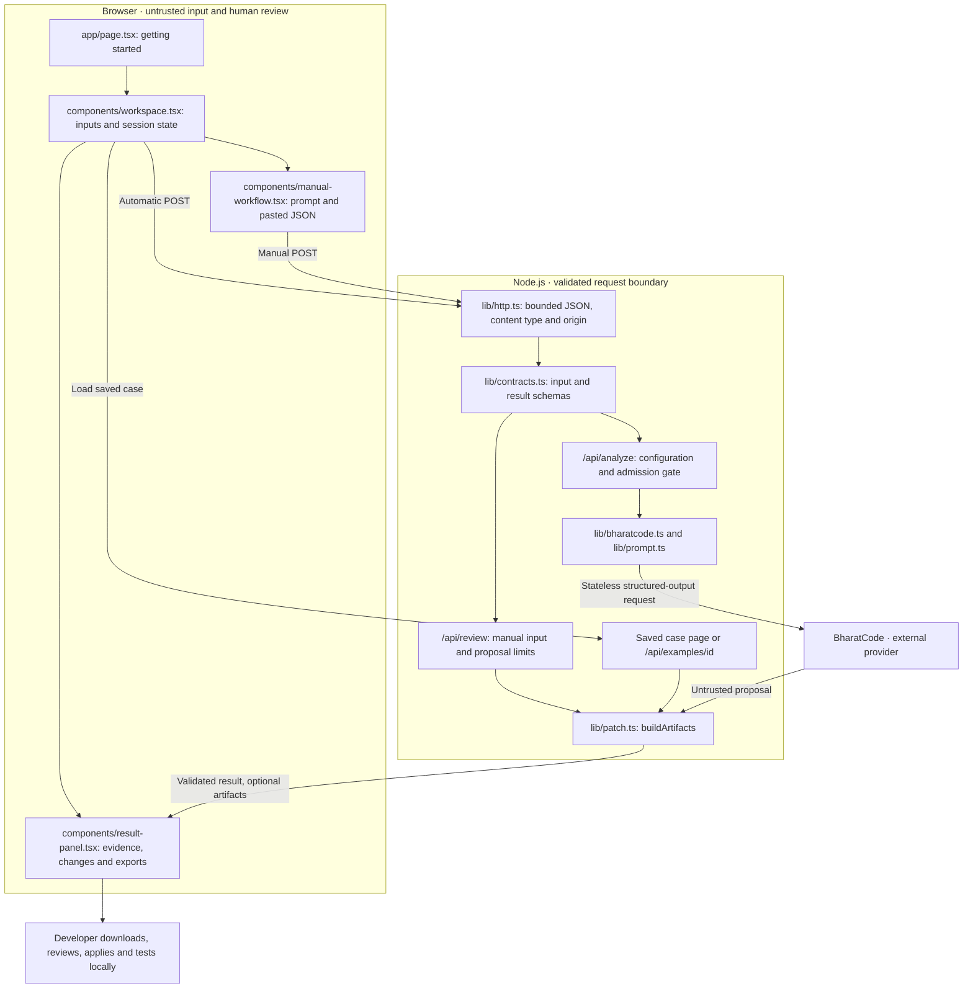
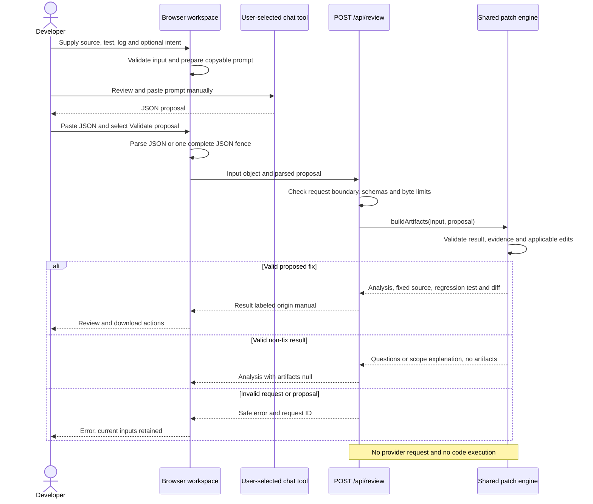
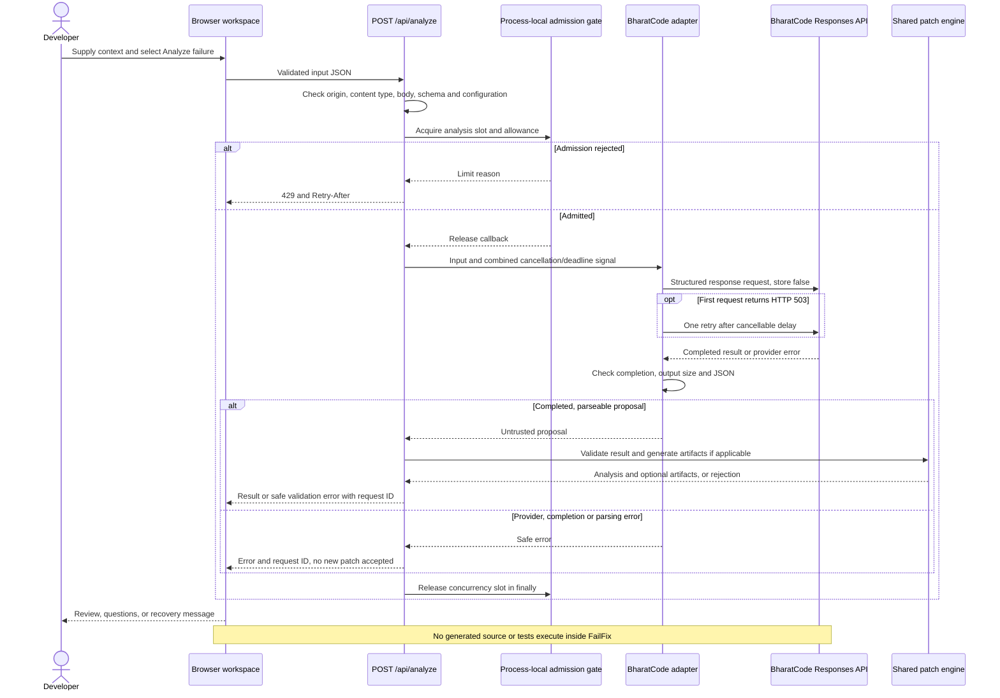

# Architecture and workflow

FailFix is a single Next.js App Router application. React components manage an in-memory browser session; Node.js route handlers validate requests and generate review artifacts. There is no database, authentication service, repository checkout, or code-execution service. A separate [deployment workflow](deployments.md) adds limited public GitHub configuration import and deterministic build-log review; the diagrams below describe the test-debugging workflow.

The [README](../README.md#architecture) includes system and end-to-end workflow diagrams. This document maps those diagrams to code and describes the three request paths.

## Components and boundaries

The contract node represents input validation before routing-specific processing. Result-schema validation happens again inside `buildArtifacts`, including for saved examples. External chat use in manual mode happens outside the application and is shown in the sequence below.

## Request sequences

### Manual review: no provider key in FailFix

The browser helper in `lib/manual.ts` creates the prompt and parses pasted text. The server independently validates the request: a 128 KiB body ceiling, 64 KiB input-object ceiling, and 48 KiB serialized-proposal ceiling. The provider admission gate is not used on this route.

### Automatic analysis: optional provider integration

The route validates inputs server-side even though the browser validates before sending. Requests have a combined 90-second deadline/cancellation signal. The SDK's automatic retry behavior is disabled; the adapter permits one retry only after an explicit 503. The process allowance counts admitted analyses, including attempts that later fail; releasing a slot does not replenish that allowance.

The adapter uses the OpenAI SDK with BharatCode's base URL, a strict JSON-schema response format, and a 6,000-token output cap. Incomplete output is rejected. HTTP-mocked tests cover this adapter; live compatibility and model quality remain pending.

### Saved walkthroughs

`lib/examples.ts` contains three hand-authored cases. A deep link such as `/workspace?example=zero` builds the initial example result on the server. Selecting a case inside the workspace loads its inputs; **Open saved walkthrough** fetches `GET /api/examples/:id`. Both paths use the same `buildArtifacts` engine. Neither calls a model. Unknown page example identifiers produce a blank workspace; they do not select an arbitrary case.

## Shared patch pipeline

1. Parse the strict result schema: `proposed_fix`, `needs_context`, or `unsupported`.
2. Check that evidence ranges are ordered and inside the supplied input lines. This does not validate the truth of the explanation.
3. Return valid non-fix results with `artifacts: null`; missing context must include a question.
4. For a proposed fix, normalize line endings for matching. Require each original snippet to match exactly once in the original source. Reject no-ops, overlapping edits, and edits whose combined effect cancels out.
5. Apply edits from the highest original offset to the lowest. Preserve source CRLF line endings where present.
6. Derive a separate `.failfix.test.ts` path from the existing test path. Reject collisions with the two input paths. Check recognized literal imports against Vitest and the provided source.
7. Generate the source diff and new-test diff with `diff`; return fixed source, patch, regression path, and regression-test text. The existing test is never edited.

Literal import checks are intentionally limited. They do not prove compilation, inspect arbitrary dynamic imports, or make generated code safe. The server cannot detect collisions with other files in a repository it has never received.

## Browser session and result lifecycle

The workspace keeps inputs, proposal text, current result, and reviewed snapshots in React state. Switching editor tabs or collapsing the explorer preserves the session. Refreshing, leaving the workspace, or loading a different case can replace that state; there is no session persistence.

Evidence links select the referenced input and line range. Changes to input context mark a result stale. For manual results, changing the pasted proposal also makes it stale. The result panel disables stale exports and evidence navigation until a new result is obtained. Errors preserve current inputs and do not accept a new patch; an earlier result may remain visible.

The failure console shows user-supplied test output. It is not a terminal emulator and has no command execution. Clipboard and file-download actions happen in the browser. Applying patches and running tests happen in the developer's local repository.

## Module map

| Module                               | Responsibility                                                                          |
| ------------------------------------ | --------------------------------------------------------------------------------------- |
| `app/page.tsx`, `app/ide.css`        | Getting-started document and IDE layout                                                 |
| `app/workspace/page.tsx`             | Workspace route, example deep links and server-built initial results                    |
| `components/ide-chrome.tsx`          | Shared header and status bar                                                            |
| `components/workspace.tsx`           | Explorer, input tabs, file reads, cancellation, result snapshots and evidence selection |
| `components/manual-workflow.tsx`     | Prompt preparation, clipboard feedback and manual review submission                     |
| `components/result-panel.tsx`        | Diagnosis, evidence, changes, stale-result controls and downloads                       |
| `lib/contracts.ts`                   | Input/result schemas, types and shared byte limits                                      |
| `lib/http.ts`                        | Bounded JSON reading, content-type/origin checks and safe errors                        |
| `lib/manual.ts`                      | Local prompt creation and pasted JSON parsing                                           |
| `lib/bharatcode.ts`, `lib/prompt.ts` | Provider adapter and debugging instructions                                             |
| `lib/patch.ts`                       | Result validation, exact edits, regression path/import checks and diff generation       |
| `lib/limits.ts`                      | Process-local concurrency, allowance and optional trusted-client limits                 |
| `lib/examples.ts`                    | First-party walkthrough inputs and proposals                                            |

`GET /api/health` reports process availability without spending provider resources. It is not a provider-readiness check. Analysis and review responses use `Cache-Control: no-store` and request IDs. Automatic-analysis logs contain operational status/timing/model/token metadata, not submitted code or prompts.

## Trust and data boundaries

- Source, logs, manually supplied proposals, and model outputs are untrusted data. There are no model tools, shell commands, or code-runner privileges.
- The server checks input paths as relative identifiers; it never writes uploaded paths to its filesystem.
- React renders code as text; model HTML is not inserted as HTML.
- Provider credentials stay server-side. `store: false` is requested from the provider; this is not a claim about all provider retention policies.
- Code, prompts, and results have no application database or browser-storage persistence. Requests still transmit content to the relevant server; manual use of a chat tool follows that tool's terms.
- Exact source matching establishes applicability, not semantic correctness, test coverage, or security. Prompt instructions do not establish immunity to prompt injection.
- The current automatic-analysis gate is process-local. It is not a multi-replica limit or durable billing cap, and it does not govern manual review.

## Design tradeoffs

One language and one test framework keep the scope reviewable. Nonstreaming structured output keeps partial patches out of the result flow. Deterministic diff generation avoids accepting arbitrary generated patch text. No hosted execution avoids introducing a code runner into this release. Deployment and shared infrastructure remain deferred until hosting is selected; see [operations](operations.md).
