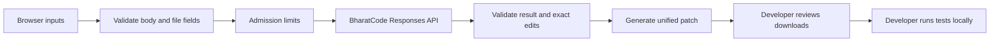

# Architecture

FailFix is one Next.js/TypeScript app with a browser workspace and Node.js route handlers. It has no database, account system, repository credentials, or model tools.

## Modules

| Module                        | Responsibility                                                                                     |
| ----------------------------- | -------------------------------------------------------------------------------------------------- |
| `components/workspace.tsx`    | Input tabs, file reads, examples, analysis state, cancellation, stale results, evidence navigation |
| `components/result-panel.tsx` | Diagnosis, evidence, source diff, regression test, copy/download actions                           |
| `lib/contracts.ts`            | Shared input/result schemas, byte limits, types                                                    |
| `lib/bharatcode.ts`           | Real provider SDK call, bounded busy retry, safe errors                                            |
| `lib/prompt.ts`               | Task instructions and treatment of source/logs as untrusted data                                   |
| `lib/patch.ts`                | Exact-match edits, evidence bounds, limited literal-import checks, deterministic diff              |
| `lib/limits.ts`               | Single-process concurrency, allowance, and optional per-client limits                              |
| `lib/examples.ts`             | Explicitly hand-authored walkthrough content                                                       |

## Request lifecycle

`POST /api/analyze` checks content type and origin, reads at most 64 KiB, validates fields, checks configuration and admission limits, and sends a stateless structured-output request to BharatCode. The provider request has a 90-second deadline and at most one retry for an explicit 503. Incomplete output is rejected even if the HTTP response succeeds.

The model can propose up to three source edits. Each original snippet must match exactly once after LF normalization; overlaps and no-ops are rejected. Edits use original offsets and are applied from last to first. Source CRLF endings are retained. The app derives the separate regression-test path from the existing test path, preserves existing tests, and generates both source and new-test diffs.

Successful responses contain the validated analysis, artifacts where applicable, a request ID, and elapsed time. Failures return a safe code/message and request ID. Operational logs contain timing/status/model/token/request metadata only. Responses use `Cache-Control: no-store`.

`GET /api/examples/:id` runs the same patch generator over first-party walkthrough data without calling a model. `GET /api/health` checks process availability without spending provider resources.

## Trust boundaries

- User code, logs, and model output are data. Neither tools nor a code runner are exposed to the model.
- Validation proves a limited structural property: the proposed edit applies to the provided source. It does not prove the diagnosis or generated code is correct.
- Literal import checks are a convenience, not a security sandbox; dynamic imports and arbitrary generated code are not proven safe. Review all downloads before execution.
- Input paths are validated relative identifiers, never filesystem write destinations on the server.
- Browser rendering escapes text; model HTML is never inserted as HTML.
- Provider secrets stay on the server. No persistence is used for code, prompts, or results.
- Code/log instructions can influence a model despite prompt precautions; no live prompt-injection robustness claim has been established. The lack of model execution privileges limits the consequences inside this app.
- The server cannot know whether a generated test path already exists in the user's full repository. Users must review collisions locally.

## Intentional tradeoffs

One language and framework keep examples and tests reproducible. Nonstreaming structured output keeps incomplete patches out of the interface. Exact-text edits avoid trusting a generated diff parser. No hosted execution avoids building an unsafe code runner. One process avoids introducing shared infrastructure before hosting is selected; operations documents when this must change.
