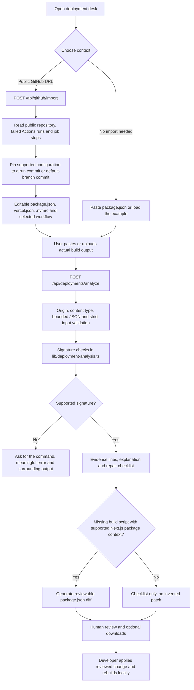

# Deployment investigations

The deployment desk at `/deployments` reviews build failures without a model-provider key. It combines an optional public GitHub configuration import with logs the user supplies. This is separate from the TypeScript/Vitest proposal workflow at `/workspace`.

## Workflow and architecture

## Public import

- Accepts `owner/repository` or an HTTPS `github.com` repository URL, including a `.git` suffix.
- Makes credential-free GET requests to a fixed `api.github.com` origin. Redirects are rejected; user URLs cannot select an arbitrary fetch target.
- Loads up to six recent failed Actions runs. Selecting a run pins all imported files to that run's head commit. Without a failed run, the importer resolves the default branch to a commit.
- Reads only root `package.json`, `vercel.json`, `.nvmrc`, and the selected run's supported `.github/workflows/*.yml` or `.yaml` path. Each file is limited to 16 KiB; there is no clone, archive extraction, recursive import, or dependency installation.
- Shows failed job-step names as **metadata**, never as the underlying error log. Logs must be pasted or uploaded separately. The current importer does not download job logs or artifacts.
- Uses a 20-second overall deadline, bounded upstream JSON responses, and at most two concurrent imports per application process. GitHub's unauthenticated API allowance and availability still apply; this is not a durable abuse-control system.
- Private repositories, GitHub account connection, repository writes, PR creation, and deployment triggers are deferred. No GitHub token is required or read by this release.

Importing preserves existing log text and explicitly asks the user to confirm that it belongs to the chosen commit. An import error preserves current input. Imported configuration can be edited before review; the commit displayed is its original reference, not proof that edited text matches GitHub.

## Signature checks

| Signature family                   | Output                                                                               |
| ---------------------------------- | ------------------------------------------------------------------------------------ |
| Missing `build` script             | Evidence and working-directory checks; optional Next.js config patch                 |
| Lockfile / package-manager failure | Checklist for the correct package manager, dependency changes and committed lockfile |
| Node runtime mismatch              | Runtime compatibility and CI/host setup checks                                       |
| Missing environment setting        | Host/CI scope checks; no secret values generated or patched                          |
| Module resolution failure          | Dependency, relative-path and filename-casing checks                                 |
| TypeScript failure                 | Guidance to inspect the referenced application code and repeat checks                |
| Memory-pressure signature          | Resource and build-stage checks; no automatic resource changes                       |

These checks are deterministic patterns, not model diagnoses or guarantees of root cause. Some errors can have multiple causes. No match produces `needs_context`, rather than a fabricated fix.

The only generated repair currently adds `"build": "next build"` when the log reports a missing build script and the supplied root package declares Next.js, has no build script, and declares no workspaces. Existing scripts are preserved. JSON may be reformatted. Users must confirm the deployment root and framework configuration before applying the patch. No arbitrary application-source repair is attempted by this engine.

## Review and data boundaries

The input schema accepts at most four distinct supported config files, each up to 16 KiB, and a log up to 32 KiB. The combined request body is capped at 128 KiB. The UI accepts UTF-8 `.txt` or `.log` uploads. Inputs and results stay in browser memory and are not persisted by the application. Review sends content to this app's server but makes no provider requests. Remove credentials and confidential content before pasting.

Evidence buttons select the relevant log lines. Changing log or config text disables stale exports and evidence links until a new review. Users can download a JSON repair report and, where supported, a unified patch. Neither action changes a repository. Review the patch against the intended commit and local working tree, apply it yourself, and repeat the original install/build before deploying.

Relevant modules: `lib/github-public.ts`, `lib/deployment-contracts.ts`, `lib/deployment-analysis.ts`, `components/deployment-workspace.tsx`, and the two route handlers above.

GitHub API behavior is documented in [repository contents](https://docs.github.com/en/rest/repos/contents#get-repository-content), [workflow runs](https://docs.github.com/en/rest/actions/workflow-runs#list-workflow-runs-for-a-repository), and [workflow jobs](https://docs.github.com/en/rest/actions/workflow-jobs).
